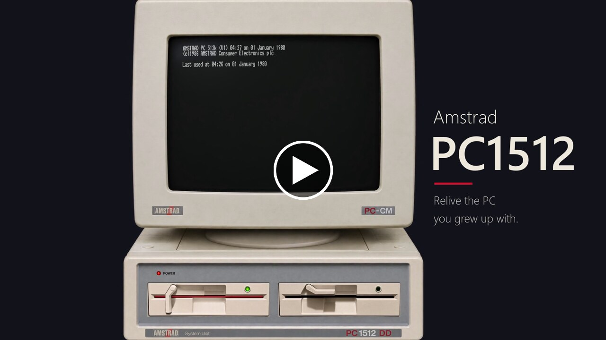
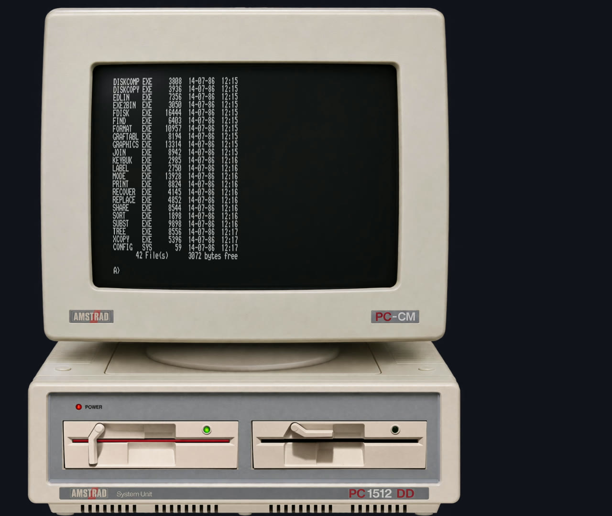
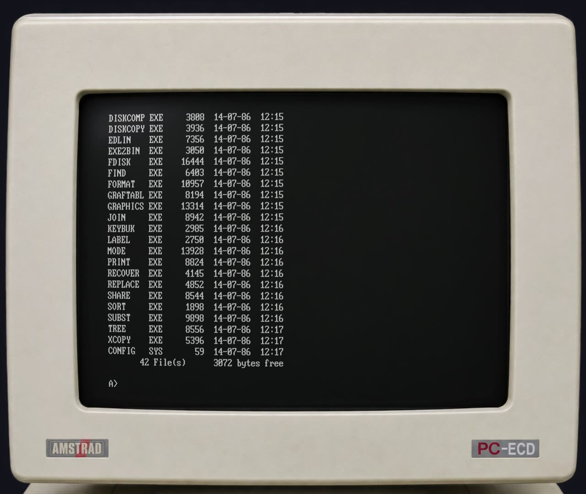
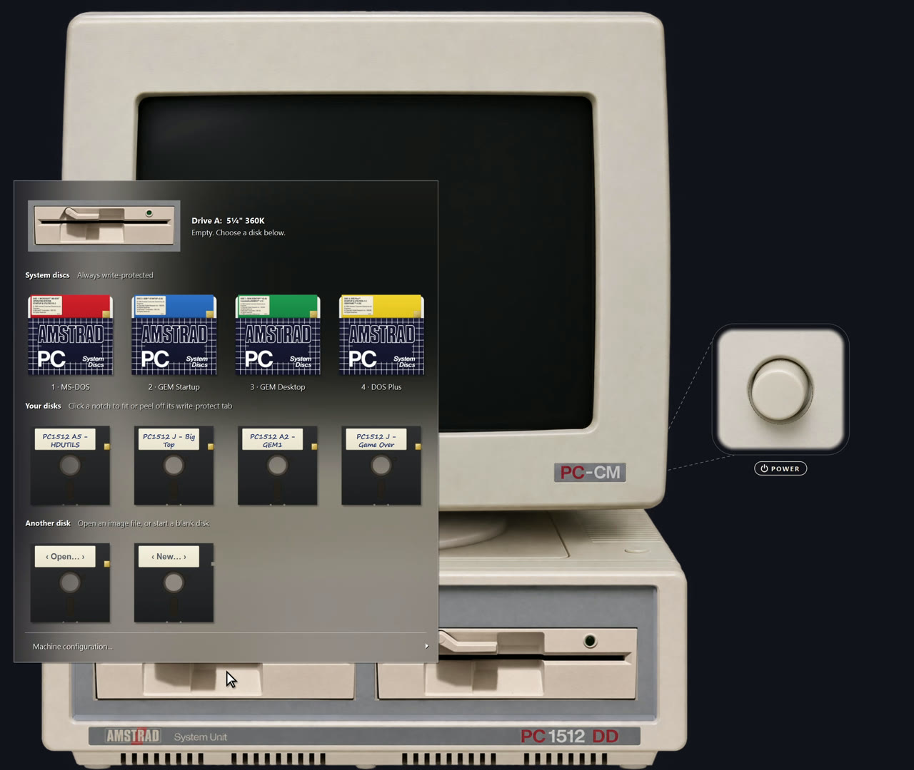
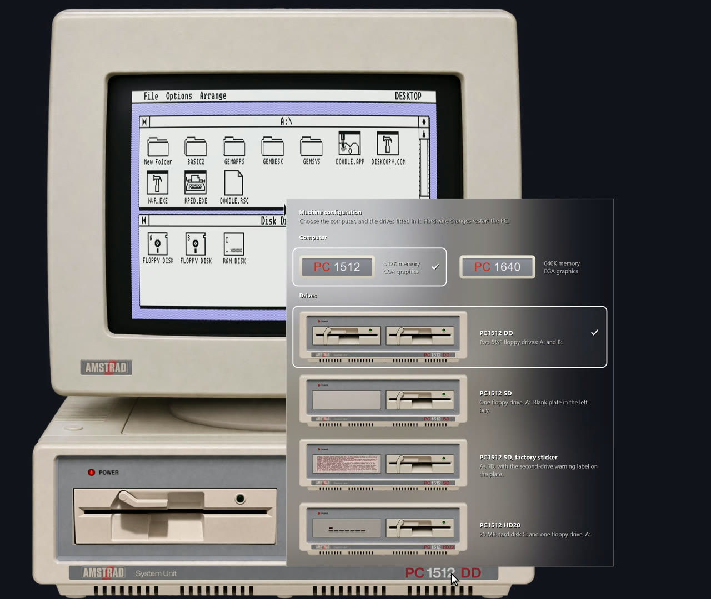
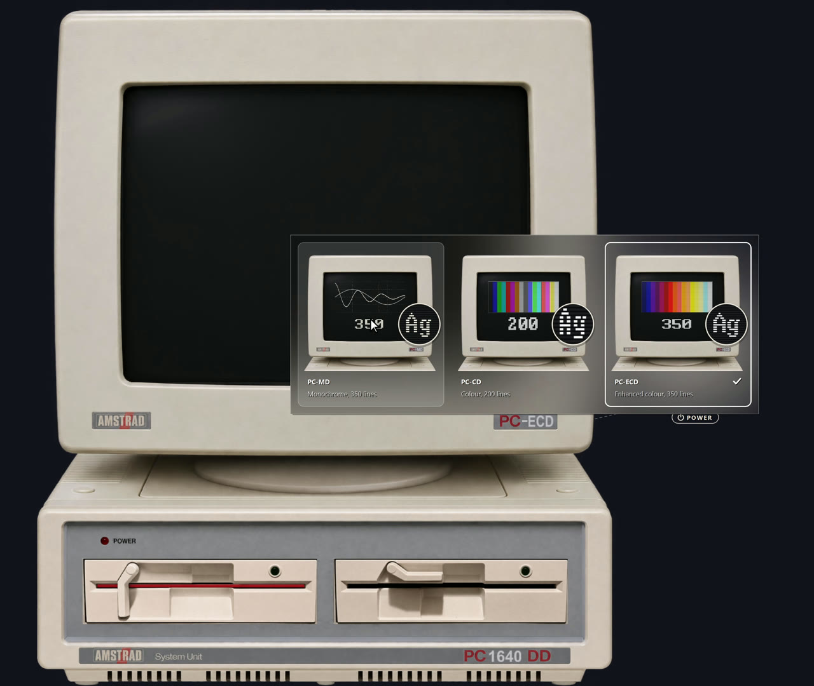
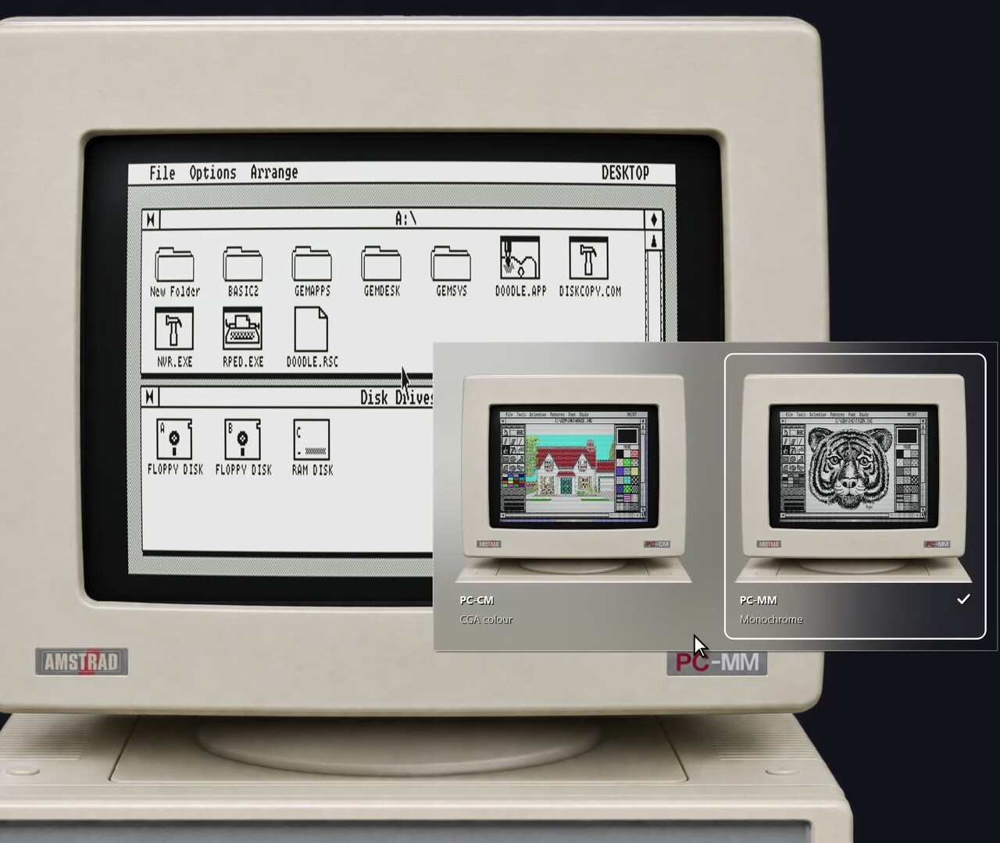

# Amstrad PC Emulator

*Remember the beige box on the desk, the clunk of the drive lever, the wait for `A>` and the first time GEM's desktop appeared on the screen?*

Amstrad PC Emulator brings back what it felt like to sit in front of an Amstrad PC1512 or PC1640. The whole computer is on your screen: switch it on at the back, push a disk into the drive, hear it seek, watch its LED glow and see DOS come up behind curved glass. There are no menus or dialogs in the way. You choose disks, machines and monitors by reaching for the computer itself.

<p align="center"><a href="https://www.youtube.com/watch?v=LJkakRkrZ3I"></a><br><em>Click to watch the video on YouTube</em></p>

**A nostalgia machine, not a museum replica.** The aim is to relive the experience of using these computers, not to reproduce them exactly. The cabinet, drives and badges are newly drawn artwork, not photographs of a real machine, so they look the part without being identical. Most sounds are borrowed for now: the floppy drives are a Panasonic JU-475-5 of the same era and the hard disk a Miniscribe 8425, not the Amstrad's own drives (yet). The machine underneath, though, is a real emulation: 86Box runs the PC1512's CPU, timing, video, floppy controller and input devices, with your own ROMs and disks.

Under the hood it is a small fork of the 86Box emulator (Qt), with a port of IBMulator's CRT shader for the glass.

<table>
  <tr>
    <td width="50%"><a href="docs/screenshots/dos.jpg"></a></td>
    <td width="50%"><a href="docs/screenshots/zoom.jpg"></a></td>
  </tr>
  <tr>
    <td align="center"><strong>MS-DOS loaded</strong> from the disk in drive A.</td>
    <td align="center"><strong>Lean in</strong> for the curved glass and the glow of the text.</td>
  </tr>
  <tr>
    <td width="50%"><a href="docs/screenshots/disks.jpg"></a></td>
    <td width="50%"><a href="docs/screenshots/config.jpg"></a></td>
  </tr>
  <tr>
    <td align="center"><strong>Insert a disk</strong> from the drive bay.</td>
    <td align="center"><strong>Choose the machine</strong> from the model badge.</td>
  </tr>
  <tr>
    <td width="50%"><a href="docs/screenshots/monitor.jpg"></a></td>
    <td width="50%"><a href="docs/screenshots/monitor-mono.jpg"></a></td>
  </tr>
  <tr>
    <td align="center"><strong>Swap the monitor</strong> from its badge: the PC1640 offers PC-MD, PC-CD and PC-ECD.</td>
    <td align="center"><strong>Colour or mono</strong> on the PC1512: GEM on the PC-MM.</td>
  </tr>
</table>

## Contents

- [Highlights](#highlights)
- [Getting started](#getting-started)
- [ROMs](#roms)
- [Disks](#disks)
- [Using the emulator](#using-the-emulator)
- [Keyboard and mouse shortcuts](#keyboard-and-mouse-shortcuts)
- [Emulated hardware](#emulated-hardware)
- [Settings and options](#settings-and-options)
- [Building from source](#building-from-source)
- [Testing](#testing)
- [Working with git](#working-with-git)
- [License](#license)
- [Distributing a build](#distributing-a-build)

## Highlights

- **The cabinet is the interface.** Click the drive bays to insert disks, the model badge to choose the machine and drives, the monitor badge to swap monitors, and the AMSTRAD plate for About.
- **PC1512 and PC1640**, each in DD, SD or HD20 (20 MB hard disk) layouts, with the matching monitors: PC-MM and PC-CM, or PC-MD, PC-CD and PC-ECD.
- **Live front panel.** The power LED and each drive's LED follow the emulated hardware.
- **Drive sounds.** Motor, seek and spindle sounds from period drives: a Panasonic JU-475-5 for the [floppies](https://github.com/andresdelcampo/RetroDriveSounds) and a Miniscribe 8425 for the HD20.
- **CRT glass.** Curvature, reflections and the cabinet's dark glass around a sharp CGA picture.
- **Monitor close-up** and fullscreen, with a square cabinet and a 4:3 display at any window size.

## Getting started

You need two things the emulator cannot include: the Amstrad's ROMs and some disks to boot.

1. **Add the ROMs.** Take the PC1512 files `40043`, `40044` and `40078` from [86Box's ROM set](https://github.com/86Box/roms) and put them in `roms\machines\pc1512\` beside `Amstrad PC1512.exe`. Copying the whole `roms` folder of an 86Box installation also works, and covers the PC1640 and HD20 too. Details in [ROMs](#roms).
2. **Get some disks.** Any 360 KB disk images will do: the Amstrad system discs in your language, a bootable game, or your own disks. For example, the English PC1512 system discs are at [Amstrad PC1512 System Disks](https://archive.org/details/PC1512_System_Disks). More sets are listed in [Disks](#disks).
3. **Start the emulator.** Double-click **`Amstrad PC1512.exe`**. The computer appears switched off, with empty drives.
4. **Insert a bootable disk.** Click drive A (the left slot) and choose a disk: one of the system discs (MS-DOS or DOS Plus), **Open…** for any other image, or one you used before. A system disc with no image yet asks for its file the first time.
5. **Switch on.** Press the round **power button** in the close-up to the right of the monitor. The PC boots from drive A, just as the real one did.

**On Linux (experimental)**, download the `…-linux-x86_64.tar.gz` release instead and unpack it. Install the libraries it uses once (see [Linux](#linux-experimental) for the command), put the ROMs in `roms/machines/pc1512/`, and run `./amstrad-pc1512.sh` where the steps above say `Amstrad PC1512.exe`.

**If the first launch shows a "cabinet image is missing" or "could not be read" message**, your antivirus (Avast, for example) is checking the new download. Click **OK** on the messages, and the emulator may show a black window for a moment. Once the check has finished, which takes a few seconds, the antivirus starts the emulator again and it opens normally; it is safe to run. Nothing is wrong with the download. If this happens on every launch, add the folder as an exception in your antivirus.

Swap disks at any time from the drive bays, and press Ctrl+F12 to restart. On the Amstrad system discs, typing `gem` at the MS-DOS prompt starts GEM, which asks for its discs as it needs them.

## ROMs

No firmware is included; it remains your own. The emulator uses the same ROM files, with the same names and layout, as [86Box's ROM set](https://github.com/86Box/roms); the set that came with 86Box 6.0 is known to work. Copy the files below from it, or the whole `roms` folder of an 86Box installation, into the `roms` folder beside `Amstrad PC1512.exe`:

| For | Folder | Files (size) |
|---|---|---|
| PC1512 | `roms\machines\pc1512\` | `40043`, `40044`, `40078` (8 KB each) |
| PC1640 | `roms\machines\pc1640\` | `40043.v3`, `40044.v3` (16 KB each), `40100` (32 KB) |
| HD20 hard disk | `roms\hdd\st506\` | `wd1002a_wx1-62-000094-032.bin` (Western Digital WD1002A-WX1 controller) |

Only the PC1512 ROMs are needed to start. The PC1640 and HD20 ROMs are needed only to run those configurations.

## Disks

No disks are included either. Insert your own 360 KB images from the drive bays: the four Amstrad system discs (MS-DOS, GEM Startup, GEM Desktop, DOS Plus), the HD20's hard disc utilities, or any other disk. The menu remembers recent disks and where each system disc's image is, and a disc with no image asks for its file on the first click. System discs always go in write-protected. See [Cabinet menus](docs/CABINET-MENUS.md).

The English PC1512 system discs are available as ready-to-use 360 KB images at [Amstrad PC1512 System Disks](https://archive.org/details/PC1512_System_Disks) on the Internet Archive: `Disk1.img` (MS-DOS 3.2), `Disk2.img` (GEM Startup), `Disk3.img` (GEM Desktop and Locomotive BASIC 2) and `Disk4.img` (DOS Plus and GEM Paint).

The PC1640 shipped with its own set, with GEM drivers for its EGA graphics:

- English: the PC1640's MS-DOS 3.2 disc is `msdos47001.img` in [MS DOS v3.2 for Amstrad PC](https://archive.org/details/MSDOSV32Amstrad).
- Italian: the full set of four discs (MS-DOS 3.2, GEM Boot, GEM Desktop, GEM Apps) is in [Amstrad PC1640 System Disks Italian](https://archive.org/details/Amstrad_PC1640_Ita).

### Preparing the HD20

The HD20's hard disk starts out blank, so C: does not exist yet. Boot from a system disc in drive A, then run `FDISK` to create an active DOS partition, restart, and run `FORMAT C: /S` to format it and copy the system files (use the HD20 utilities disc if your MS-DOS disc has no `FDISK`). Both programs come from your own discs; none are included. Afterwards the PC boots from C: and the disc in drive A can be removed.

## Using the emulator

### Power

- The rear power-button close-up **stays visible while the PC is off**. While it is on, hover or click the **space to the right of the monitor** (even when the close-up is hidden) to bring it back.
- The same round beige button switches the PC on and off. Off leaves the cabinet with dark glass and LEDs; on starts a fresh boot. There is no reset button; use **Ctrl+F12** instead.
- Right-click the close-up to choose between **Button close-up** and **Rear cable bay**; the choice is remembered. [Power button details](docs/POWER-BUTTON.md).

### Mouse

- Click inside the live screen to capture the mouse. Clicks on the cabinet, glass borders and background leave it free.
- **Ctrl+End** or the **middle mouse button** releases it. Each time the mouse is captured, a short hint on the monitor bezel shows these keys.
- Release the mouse before using the power button or cabinet menus.

### Cabinet menus

Hover briefly over a part of the cabinet to open its menu, or left- or right-click to open it at once. Move away, click outside or press Escape to dismiss.

| Part | Opens |
|---|---|
| Drive bays | Disk choice on labelled floppy cards, with write-protect tabs |
| Model badge (system unit) | Machine configuration: PC1512 or PC1640, and the drive layout (DD, SD, HD20) |
| Monitor badge | Monitor choice, with picture previews |
| AMSTRAD plate (system unit) | About |

Choosing the PC1640 restarts the PC as that machine; its monitor badge then offers the PC-MD, PC-CD and PC-ECD. [Menu details](docs/CABINET-MENUS.md) · [PC1640 details](docs/PC1640.md).

### Window, fullscreen and close-up

- Three small controls in the upper-right corner switch between the **whole computer and the monitor close-up** (magnifying glass), between **fullscreen and windowed** (middle) and **close** the emulator (X). Resting the pointer on one shows what it does and its keys. The **mouse wheel** over the cabinet does the same as the magnifying glass, a quarter of the way per notch, so you can stop partway (while the mouse is not captured).
- The **?** mark in the lower-right corner names the cabinet's live parts and shows a KEYS card with every shortcut while the pointer rests on it.
- These four controls hide while the guest holds the mouse, and fade out after the mouse rests for 2.5 s.
- The monitor close-up fills the window with the monitor, bezel included. Whether you left it closer or farther is remembered (a partial zoom is restored as whichever end is nearer).
- Resize freely: the cabinet stays square and the display stays 4:3.
- The first launch opens fullscreen. Later launches restore the last fullscreen, maximized or windowed state, size and position. Power-on keeps the current window mode and leaves the mouse free.

## Keyboard and mouse shortcuts

| Keys | Action |
|---|---|
| **Ctrl+End** or middle mouse button | Release the captured mouse |
| **Ctrl+F12** | Send Ctrl+Alt+Del to the guest (windowed or fullscreen) |
| **Ctrl+F11** | Whole computer ↔ monitor close-up |
| **Mouse wheel** (over the cabinet, mouse not captured) | Zoom toward the monitor (up) or back out (down), a quarter at a time |
| **F11**, **Alt+Enter** or Ctrl+Alt+PageUp | Windowed ↔ fullscreen |
| **Alt+F4** | Close the emulator, even while the mouse is captured |
| **Escape** | Dismiss an open cabinet menu |
| **P** (in the disk menu) | Fit or peel the write-protect tab of the focused disk |

Keyboard notes:

- The **Windows** and **Menu** keys are left to the host, since the Amstrad keyboard has neither.
- The ISO key between left Shift and Z sends the original key's `2Bh` scan code. Its character depends on the guest's keyboard driver: with `KEYBUK` it types `\`, or `|` with Shift.

## Emulated hardware

- **Floppy drives:** both are 5.25-inch 360K, with the motor and seek sounds of a **Panasonic JU-475-5** ([source](https://github.com/andresdelcampo/RetroDriveSounds)).
- **Hard disk (HD20):** a 20 MB drive with the [spindle and seek sounds](https://github.com/86Box/assets) of a **Miniscribe 8425**, a 1987 drive of the same class. The head clicks while DOS reads and writes C:.
- **Front LEDs:** the red power LED is lit while the machine runs. Each drive's green LED is lit while its motor runs, as on a real drive.
- **Display:** a CRT shader adds the screen's curvature, and the cabinet's dark glass and reflections stay visible beneath the picture. [Shader details](docs/IBMULATOR-CRT.md).

## Settings and options

| Setting | Where | Effect |
|---|---|---|
| `-NoCRT` | After the launcher in a shortcut's target | Disable the CRT shader |
| `AMSTRAD_CAPTURE_HINT=0` | Environment | Hide the mouse-release hint |

## Building from source

Requires `C:\msys64\mingw64` with GCC, CMake, Ninja, Qt5, SDL2, OpenAL and the libraries CMake resolves.

For a fresh source checkout, fetch the pinned upstream commits listed in [UPSTREAM.md](UPSTREAM.md), then apply `patches/86box-pc1512.patch` with `scripts/apply-patch.ps1`. Build and launch:

```powershell
powershell -NoProfile -ExecutionPolicy Bypass -File scripts/build.ps1
```

```powershell
powershell -NoProfile -ExecutionPolicy Bypass -File scripts/launch.ps1 -Wait
```

`build.ps1` also rebuilds `Amstrad PC1512.exe` from `launcher/amstrad-launcher.c`. `scripts/launch.ps1` remains for the baseline and test-pattern modes.

Build notes:

- Optional MIDI engines, dynarec, disassembler, Discord and translations are disabled; the PC1512 model is unchanged. Runtime DLLs are deployed beside the executable.
- At build time only, deployment copies the Panasonic floppy and Miniscribe hard disk sounds (just those profiles and recordings, with 86Box's floppy credits) from an installed 86Box's `C:\Emulators\86Box\assets\sounds\fdd` and `...\hdd` into `local/dist/assets/sounds/`, so the built emulator carries them. The deployed table plays the Miniscribe's own spin-down recording (upstream reuses spin-up). For another installation, pass `-FloppySoundSource <path>` and `-HardDiskSoundSource <path>` to `scripts/build.ps1` or `scripts/deploy.ps1`. Fresh VMs select the Panasonic profile for both drives; existing VM preferences are kept.
- The executable and window icon is `assets/front/pc1512-front.ico`, made from the cabinet artwork `assets/front/pc1512-front.png`. To regenerate it, run the command below and rebuild:

```powershell
magick assets/front/pc1512-front.png -define icon:auto-resize=256,128,96,64,48,32,24,16 assets/front/pc1512-front.ico
```

86Box source: `978030cd0dc626bab794e74c8ddaa512c1a9fcc9` (7.0 development). Installed comparison: 6.0 build 9001.

### Linux (experimental)

Linux runs the same patched source. It has been tested only in a virtual machine, Ubuntu 24.04 in VirtualBox 7.2.4, not yet on a real Linux PC. The release is built on Ubuntu 22.04 and runs on Ubuntu 22.04 or later (and similar Debian-based systems) with these libraries installed:

```sh
# Ubuntu 24.04 or later
sudo apt install libqt5widgets5t64 libqt5network5t64 libqt5gui5t64 qtwayland5 libsdl2-2.0-0 \
  libopenal1 libsndfile1 libslirp0 libserialport0 libevdev2 libxkbcommon-x11-0 libxi6 \
  libfreetype6 libpng16-16 libzstd1
# Ubuntu 22.04: the same, with libqt5widgets5 libqt5network5 libqt5gui5 for the first three
```

- `./amstrad-pc1512.sh --install-desktop` adds **Amstrad PC1512** to the desktop's app menu. Started from there, no terminal window appears.
- On a Wayland desktop (Ubuntu's default) the launcher runs the emulator as a Wayland program, which captures the mouse with Wayland's pointer lock; that needs `qtwayland5`. `QT_QPA_PLATFORM=xcb ./amstrad-pc1512.sh` forces X11.
- In VirtualBox, turn off **Input > Mouse Integration** before clicking into the PC's screen: with it on, the desktop cannot lock the pointer and the mouse does not reach the PC.
- Differences from Windows: a status bar shows below the cabinet in windowed mode. Without 3D acceleration (as in most virtual machines), the CRT glass is drawn by the CPU, and zooming may make the sound crackle; `./amstrad-pc1512.sh -NoCRT` turns the glass off.

To build it, install the build packages (Debian/Ubuntu names):

```sh
sudo apt install build-essential cmake ninja-build pkg-config qtbase5-dev qtbase5-private-dev \
  qttools5-dev libqt5opengl5-dev libsdl2-dev libopenal-dev libfreetype-dev libsndfile1-dev \
  libslirp-dev libpng-dev zlib1g-dev libzstd-dev libevdev-dev libxkbcommon-x11-dev libxi-dev \
  libx11-dev libwayland-dev extra-cmake-modules libserialport-dev libvdeplug-dev
```

Fetch the upstream sources and apply the patch as in [UPSTREAM.md](UPSTREAM.md) (`git -C upstream/86Box apply ../../patches/86box-pc1512.patch`), put the ROMs in `roms/machines/pc1512/`, then build and start:

```sh
scripts/build-linux.sh --sounds <folder>
./amstrad-pc1512.sh
```

- `build-linux.sh` builds into `local/build-linux` and deploys to `local/dist-linux`, beside the Windows build, so one folder can serve both systems and share the `local/amstrad` VM.
- Drive sounds: `--sounds` takes a deployed `assets/sounds` folder (for example `local/dist/assets/sounds` from a Windows build, which is the default when present) or an 86Box installation's `assets/sounds`. Without it the drives are silent. The power button click and the disk insert and eject sounds come from this repository.
- WSL2 works for building (with WSLg it also runs, but its mouse capture does not).

## Testing

```powershell
powershell -NoProfile -ExecutionPolicy Bypass -File scripts/test-scene.ps1
python scripts/verify-milestone.py
python scripts/verify-milestone.py --shader
python scripts/verify-milestone.py --floppy-sounds
python scripts/verify-milestone.py --machine pc1640
```

Verification boots a separate disposable VM offscreen from the MS-DOS and GEM Startup images in `C:\Emulators\86Box\Disks` (pass `--disks <folder>` for another place; `--roms` likewise), sends scancode keyboard input, reads both drives, tests key release on focus loss, saves application and raw captures, and checks a clean exit. Normal launches open no automation socket.

The floppy sound check records the dedicated drive sound stream during independent reads of A: and B:, checks that it returns to silence between reads, and verifies that the profile persists.

## Working with git

Read [UPSTREAM.md](UPSTREAM.md) first. `upstream/` (86Box, IBMulator) is not tracked, and 86Box is edited in place, so git only protects those edits through `patches/86box-pc1512.patch`.

- **Before every commit that follows changes under `upstream/86Box`, run `python scripts/export-patch.py` and commit the updated patch.**
- Do not commit ignored areas: `upstream/`, `roms/` (your firmware), `local/` (builds, disks, VM state), `backups/`, `video/`, `assets/reference/`, `assets/front/backups/`, built `*.exe`. Review any new large binary first.
- Do not change the pinned upstream commits in `UPSTREAM.md` without a reason; if they change, update the table and re-export the patch.
- Pushing needs `git config http.sslBackend schannel` (already set in this clone; antivirus HTTPS scanning breaks git's default certificate bundle).
- New files that go into 86Box carry a GPL-2.0-or-later header, like 86Box. Do not add GPL-2.0-only or GPL-incompatible code to the build.

## License

The **combined program** (patched 86Box, IBMulator CRT shader, launcher) is distributed under the
[GNU GPL, version 3 or later](LICENSE). 86Box is GPL-2.0-or-later, which allows this; IBMulator's shader is
GPL-3.0-or-later. Original code, scripts and documentation in this repository are under the same terms.

Components keep their own notices:

- `patches/86box-pc1512.patch` modifies [86Box](https://github.com/86Box/86Box) (GPL-2.0-or-later; see
  `upstream/86Box/COPYING`). The PCE-derived `cassette.c`/`cassette.h` (GPL-2.0-only, unused by any Amstrad
  machine) are replaced by an independent no-op stub, so the compiled build contains no GPL-2.0-only code.
  See [CHANGES.md](CHANGES.md).
- `assets/shaders/` contains a port of IBMulator's CRT shader (GPL-3.0-or-later);
  see `assets/shaders/NOTICE-IBMulator.md` and `assets/shaders/COPYING-IBMulator`.
- Runtime DLLs and other bundled components are listed in [THIRD-PARTY-NOTICES.md](THIRD-PARTY-NOTICES.md).
- [Floppy-drive sounds](https://github.com/andresdelcampo/RetroDriveSounds) were recorded by the project author. Front-panel artwork was created by the author with AI
  image tools ([provenance](docs/front-artwork.md)); no third-party artwork is reproduced.
- Amstrad and PC1512/PC1640 are trademarks of their respective owners. ROMs and software are not included and
  remain the user's own.

## Distributing a build

Run `scripts/build.ps1`, commit and tag, then `scripts/make-release.ps1`. It creates `local/release/AmstradPCEmu-<version>/`
(launcher, binaries, cabinet artwork, the first-launch setup script, empty `roms` folders with a note on what goes where, licence texts and notices) and `AmstradPCEmu-<version>.zip` of it. Attach the zip to a GitHub release of the tag; GitHub adds the source archives itself, and they include `patches/86box-pc1512.patch` and the pinned 86Box commit in `UPSTREAM.md`. No ROMs, disks or VM state are included.

For Linux, run `scripts/build-linux.sh` on Ubuntu 22.04 (WSL2 works), then `scripts/make-release-linux.sh --version <version>`. It creates `local/release/AmstradPCEmu-<version>-linux-x86_64/` with the same contents (the Linux launcher and `prepare-vm.sh` instead of the Windows ones) and a `.tar.gz` of it, which keeps the executable bits. Attach it to the same GitHub release.
